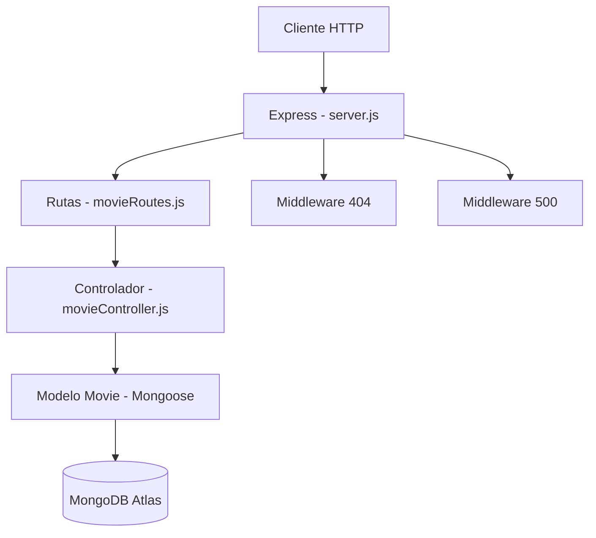

# Strea API

API REST desarrollada con Node.js, Express y MongoDB Atlas para gestionar un catálogo personal de películas.

## 1. Descripción del proyecto

Strea es una aplicación que permite gestionar un catálogo personal de películas. La API permite consultar, registrar, actualizar y eliminar películas almacenadas en una base de datos MongoDB.

El proyecto forma parte de la práctica PEC 3 de Desarrollo Full Stack.

## 2. Tecnologías utilizadas

- Node.js
- Express
- MongoDB Atlas
- Mongoose
- JavaScript (ES Modules)
- dotenv
- Git y GitHub
- Vercel

## 3. Estructura del proyecto

```text
strea-api/
│
├── config/
│   └── db.js
│
├── controllers/
│   └── movieController.js
│
├── middlewares/
│   └── errorMiddleware.js
│
├── models/
│   ├── User.js
│   └── Movie.js
│
├── routes/
│   └── movieRoutes.js
│
├── .env
├── .env.example
├── .gitignore
├── package.json
├── package-lock.json
├── server.js
├── strea.http
└── README.md
```

## 4. Modelos de datos

### User

Representa a los usuarios de la aplicación.

| Campo | Tipo |
|---|---|
| name | String |
| email | String |
| password | String |

### Movie

Representa las películas del catálogo personal.

| Campo | Tipo |
|---|---|
| title | String |
| year | Number |
| genre | String |
| watched | Boolean |
| userId | String |

## 5. Endpoints de la API

La API utiliza la ruta base `/api/movies`.

| Método | Endpoint | Descripción |
|---|---|---|
| GET | /api/movies | Obtener todas las películas |
| GET | /api/movies/:id | Obtener una película por ID |
| POST | /api/movies | Crear una película |
| PUT | /api/movies/:id | Actualizar una película |
| DELETE | /api/movies/:id | Eliminar una película |

### Ejemplo de creación de película

```json
{
  "title": "Interstellar",
  "year": 2014,
  "genre": "Ciencia ficción",
  "watched": false,
  "userId": "user_001"
}
```

## 6. Instalación y ejecución

1. Clonar el repositorio:

```bash
git clone URL_DEL_REPOSITORIO
```

2. Entrar en la carpeta del proyecto:

```bash
cd strea-api
```

3. Instalar las dependencias:

```bash
npm install
```

4. Configurar las variables de entorno en un archivo `.env`.

5. Ejecutar el servidor:

```bash
node server.js
```

El servidor utiliza el puerto 4000 por defecto, salvo que se configure otro mediante la variable `PORT`.

## 7. Variables de entorno

El proyecto utiliza dotenv para gestionar las variables de entorno.

Crear un archivo `.env` con las siguientes variables:

```env
MONGODB_URI=tu_uri_de_mongodb_atlas
PORT=4000
```

No compartir ni subir el archivo `.env` al repositorio.

El archivo `.env.example` contiene una plantilla de las variables necesarias.

## 8. Middleware y gestión de errores

La API incorpora middleware para gestionar errores:

- **404:** devuelve una respuesta cuando la ruta solicitada no existe.
- **500:** gestiona los errores internos del servidor y devuelve una respuesta JSON.

## 9. Diagrama de arquitectura



## 10. Pruebas de la API

Las peticiones HTTP se encuentran documentadas en el archivo `strea.http`.

Se han realizado pruebas de las operaciones CRUD:

- GET: consulta de películas.
- POST: creación de películas.
- PUT: actualización de películas.
- DELETE: eliminación de películas.

También se han comprobado las respuestas de los middleware de errores 404 y 500.